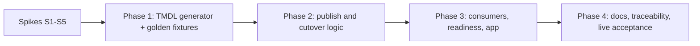

# Plan: ontology new-experience migration (ENH-010) and business rules (ENH-011)

**Status:** Offline execution complete — 2026-10-07. Live spikes and cutover
are blocked on a sign-in to the demo tenant (`9d379b85-…`). Temporary planning
artifact, not a system of record. Promote durable decisions into the
[ML/AI contracts](../../docs/design/specifications/modules/ml-ai/model-contracts.md),
[ML/AI backlog](../../docs/design/requirements/modules/ml-ai/backlog.md), and
traceability before deleting this file.

## 0. Execution log (2026-10-07)

| Item | Outcome |
| --- | --- |
| S1 TMDL shapes | **Resolved from documentation.** The 35-part WindFarm example in the format reference round-trips, and its base64 payloads give exact whitespace. A time series is an `additionalBackingTable` joined by a TOM relationship plus `type: timeSeries` properties, all behind one `Sql.Database` DirectLake expression. Native Kusto bindings have no documented TMDL form, so Eventhouse data binds through the existing Bronze `cusn` Lakehouse shortcuts. **Live check still needed.** |
| S2 projected metrics | **Resolved negative from documentation.** TMDL rejects `backingMeasure`. D4 option (c) applies: no metrics in automation, and no duplicated DAX. |
| S3 graph materialization API | Not investigated live — blocked. |
| S4 `fabric-cicd` ontology support | Not investigated — blocked. D1 chose a deploy script, `deploy/scripts/deploy_ontology.py`. |
| S5 MCP tools on the new item | Blocked. |
| Phase 1 generator | Done: `deploy/scripts/_ontology_model.py`; `tests/deploy/test_ontology_model.py`. |
| Phase 2 publisher | Done offline: `deploy/scripts/deploy_ontology.py`, with staged create, verify, delete, and rename (strengthens D2); `tests/deploy/test_deploy_ontology.py`. **Not wired into deployment.** |
| Rules (ENH-011) | Done offline: `deploy/scripts/_ontology_rules.py`, 9 rules; parity tests in `tests/deploy/test_ontology_rules.py`. |
| Phase 3 consumers / Phase 4 live acceptance | Pending live validation. |

Additional live risks found while building:
- The Truck→DC TOM relationship joins `DCID` (`double`) to `ID` (`int64`);
  the semantic model avoids it for this reason.
- Inactive TOM relationships are used as additional backing tables, which
  avoids ambiguous paths.
- One event table backs several entities.

## 1. Why now

| Fact | Source |
| --- | --- |
| The old ontology experience retires **Jan 31, 2027**. The UI can no longer create it; only the APIs and CI/CD can. | [Ontology overview — migrate](https://learn.microsoft.com/fabric/iq/ontology/overview#migrate-from-old-experience) |
| The repo still publishes the old format (`EntityTypes/{id}/definition.json`, `DataBindings/`, `RelationshipTypes/`, `Contextualizations/`). | `fabric/lakehouse/30-create-ontology.ipynb` (definition parts near lines 1067–1419) |
| The new experience uses a TMDL definition that works with Git integration, `getDefinition`/`updateDefinition`, and deployment pipelines. | [Ontology definition (TMDL)](https://learn.microsoft.com/rest/api/fabric/articles/item-management/definitions/ontology-definition) |
| Rules exist only in the new experience (`rules/{rule}.tmdl`), and agents read them through the MCP `list_ontology_rules` tool. | [Business rules](https://learn.microsoft.com/fabric/iq/ontology/how-to-use-rules) |

## 2. Platform constraints that shape the design

1. **Descriptions are native.** Entities, properties, relationships, and
   namespaces take `///` doc-comments, and reusable properties carry shared
   descriptions. The #385 workaround (Digital Operations authoring API with
   token exchange and read-back) becomes unnecessary.
2. **Semantic-model metrics are not TMDL-authorable.** DAX measures surface
   as `projected` or `enrichment` metrics, which require `backingMeasure`,
   and TMDL rejects that keyword. Only `explicit` metrics (KQL, SQL,
   Generic, or NaturalLanguage, **not DAX**) round-trip. "Generate Ontology"
   from a semantic model creates projected metrics, but only through the UI
   or the ontology agent.
3. **Bindings.** Static bindings are one OneLake-backed source per entity
   type. Time-series bindings may come from both Eventhouse and Lakehouse.
   The TMDL reference documents only the DirectLake `Sql.Database` expression
   for Lakehouse and Warehouse; the Eventhouse time-series partition and
   expression shape is undocumented.
4. **Graph is opt-in.** An ontology-derived schema graph no longer loads
   instance data by default; materialization is an explicit step. The
   notebook's `GRAPH_SETTLE_SECONDS` and "derived graph" retry logic assume
   the old behavior.
5. **Cost.** Every ontology read, including UI, MCP, and agent reads, is
   metered as *Ontology Discovery* at 1,000 CU-seconds each. MCP and
   ontology-agent reasoning are metered dynamically.
   ([capacity usage](https://learn.microsoft.com/fabric/iq/ontology/resources-capacity-usage))
6. **MCP.** Service-principal access to the ontology MCP is unsupported (a
   known issue), and preview tool names may change. The app calls
   `search_ontology` and `list_ontology_entity_types`.
7. **Activator.** The new experience has no Activator integration. The repo's
   `fabric/rules/` Activator definitions are separate manual assets and are
   unaffected.
8. **Rollout-gated features.** Inheritance (`baseEntityType`), `redefines`,
   and reusable properties may not be enabled for every tenant. Do not
   depend on them.

## 3. Current consumers that must keep working

| Consumer | Coupling |
| --- | --- |
| `deploy/scripts/ensure_ontology.py` | Runs `30-create-ontology`, then waits for `Ontology:RetailOntology_AutoGen` |
| `deploy/scripts/deploy_config.py` (`ONTOLOGY_ITEM_NAME`, parameter rewrite `$items.Ontology.RetailOntology_AutoGen.$id`) | Rebinds the ontology Data Agent |
| `fabric/data-agents/retail-ontology-agent.DataAgent/.../ontology-RetailOntology_AutoGen/datasource.json` | Draft and published datasource by display name and artifact ID |
| `fabric/taskflow/taskflow.json`, `deploy/scripts/taskflow.py` | Task-flow artifact binding by name |
| `deploy/scripts/verify_readiness.py` (around lines 1030 and 1518) | Non-required `Ontology` item and definition checks |
| `app/backend/config.py`, `main.py`, `ontology_graph.py` | MCP endpoint by item ID; graph edges **parsed from the notebook's `RELATIONSHIPS` literal** |
| Tests | `tests/deploy/test_ontology_notebook.py`, `test_ensure_ontology.py`, `test_taskflow.py`, `test_verify_readiness.py`, `tests/test_ancillary_fabric_assets.py` |

Keeping the display name `RetailOntology_AutoGen` keeps every name-based
coupling stable. Only item IDs change, and those are already resolved at
deploy time.

## 4. Design decisions

| ID | Decision | Rationale |
| --- | --- | --- |
| D1 | Generate the TMDL definition in **testable Python**, either in the notebook from a pure-function module or in a new `deploy/scripts/deploy_ontology.py` (decided by spike S4). Commit golden TMDL fixtures for unit tests. | TMDL is text, so it diffs, can be unit-tested offline, and matches the deploy-script pattern of `deploy_twins.py`. |
| D2 | Keep the display name `RetailOntology_AutoGen`. If the existing item reports the old format (`.platform` `config.version` ≠ `2.0`, or an `EntityTypes/` part), delete it and recreate it in the new format. Otherwise call `updateDefinition` in place. | Preserves every name-based consumer; deterministic cutover. |
| D3 | Keep the same entity, relationship, and key model (12 entities, 17 relationships). Move descriptions into `///` comments. Remove the authoring-API path, which also removes `THREAT-002`'s token-host allowlist surface. | Smallest behavior change, and it shrinks security surface. |
| D4 | Metrics are decided by spike S2, in this order of preference: (a) projected metrics through a supported non-TMDL create contract, if one exists; (b) a supported post-publish step; (c) **no metrics in automation**, with a documented manual "Generate metrics" step. Do **not** re-implement DAX KPIs as explicit KQL or SQL metrics. | Duplicating KPI logic would create drift from `retail_model`. |
| D5 | Graph materialization follows the "deploy everything" default **if** an API exists (spike S3). Otherwise it is a documented manual step, and the app's multi-hop features must degrade explicitly. | Matches the 2026-10-07 deploy-everything decision without inventing APIs. |
| D6 | Replace `ontology_graph.py`'s notebook-literal parsing with parsing of the committed golden TMDL (`entityRelationships.tmdl`). | The notebook literal disappears in D1; TMDL becomes the single source. |

## 5. Spikes (time-boxed, done first in a disposable workspace)

| Spike | Question | Method | Exit criteria |
| --- | --- | --- | --- |
| S1 | Exact TMDL for an **Eventhouse time-series** binding and a Lakehouse static binding with the `ag`/`au` schemas | Create a new-experience ontology in the UI with one Lakehouse entity plus an Eventhouse time series, then call `getDefinition` | Captured parts committed as redacted golden fixtures |
| S2 | Can automation create **projected metrics** from `retail_model`? | Run UI "Generate Ontology" on `retail_model`, then `getDefinition` in TMDL and in any other supported format; check whether the Create Item API accepts a non-TMDL contract | Documented yes/no with evidence; D4 choice recorded |
| S3 | Is there a **graph materialization/refresh API**? | Review the Fabric REST Graph/Ontology reference and run a test call | Documented yes/no; D5 choice recorded |
| S4 | Does `fabric-cicd` 1.3.0 publish `Ontology` items with TMDL parts and parameter rewrites of the `Sql.Database(...)` expression? | Dry-run a staged item | Decide notebook-built versus fabric-cicd versus deploy-script publication (D1) |
| S5 | Do `search_ontology` and `list_ontology_entity_types` work unchanged on a new-experience item? | Call the existing MCP endpoint against the S1 item | Contract confirmed, or app changes scoped |

## 6. Implementation phases (ENH-010)

**Phase 1 — Generator.**
- Port `ENTITY_CONFIG`, `RELATIONSHIPS`, and key and description logic into a
  pure module that emits `database.tmdl` (`compatibilityLevel: 1000000`),
  `model.tmdl`, `expressions.tmdl`, `tables/*.tmdl`, `entities/*.tmdl`,
  `relationships.tmdl`, `entityRelationships.tmdl`, and
  `namespaces/default.tmdl`.
- Use deterministic `lineageTag` values (UUIDv5 of a stable name) so updates
  replace in place.
- Tests: golden-file comparison; payload limits (descriptions ≤ 4,000
  characters, ≤ 100 synonyms); every property has a typed backing column; key
  types are only `string` or `int64`; no column-mapping tables; every
  relationship's TOM relationship exists.

**Phase 2 — Publication.**
- Detect the format, then do delete-and-recreate or `updateDefinition` (D2),
  polling long-running operations through the canonical Fabric API only.
- Remove the authoring-API, token-exchange, and `GRAPH_SETTLE_SECONDS` paths.
- Add materialization if S3 allows.
- Tests: format detection, an idempotent second run, failure leaving the old
  item intact until the new definition validates.

**Phase 3 — Consumers.**
- Data Agent ontology datasource: re-export draft and published snapshots
  against the new item.
- Readiness: assert new-format parts (`.platform` version 2.0, presence of
  `entities/`).
- `ontology_graph.py`: parse TMDL instead of the notebook literal.
- App: confirm the MCP tools (S5).
- Update `test_ontology_notebook.py` and `test_ancillary_fabric_assets.py` to
  the new contract.

**Phase 4 — Documentation and acceptance.**
- Update the ML/AI contract's ontology section, the Data Agents README,
  `deployed-analytics-ai.md` (the MCP section), and the threat model and
  traceability if D3 removes the token exchange.
- Live acceptance: full-demo deploy, ontology readiness, the ontology Data
  Agent answers the sample questions in `guides/sample-retail-questions.md`,
  and the app MCP path works. Record Ontology Discovery CU use from one
  readiness run.

## 7. Business rules (ENH-011)

Rules are generated as `rules/{name}.tmdl` by the Phase 1 generator. Each
statement is derived from the code that enforces it, and that code is the
authority. Candidate set, to be confirmed against the source before
authoring:

| Rule (working name) | Authoritative source | Linked concepts |
| --- | --- | --- |
| `PriceMinimumMargin` | `MIN_MARGIN_PCT` in `fabric/lakehouse/14-ml-dynamic-pricing.ipynb` | Product (cost, price) |
| `PriceCeilingMsrp` | `MAX_PRICE_FACTOR` (same notebook) | Product (MSRP, price) |
| `PriceChangeCadence` | `MAX_CHANGE_PCT_WEEKLY` and `MIN_DURATION_DAYS` (same notebook) | Product |
| `AgedInventoryMarkdown` | `AGE_THRESHOLD_MODERATE`/`_AGGRESSIVE` and markdown percentages (same notebook) | Product, Store |
| `PricingRequiresApproval` | `fabric/kql_database/07-pricing-approval-tables.kql` approval workflow | Product |
| `ReturnWindow` | `RETURN_WINDOW_DAYS` in `utility/src/retail_setup/generation/returns.py` | Receipt |
| `StockoutDefinition` | `STOCKOUT_THRESHOLD` in `fabric/lakehouse/12-ml-stockout-prediction.ipynb` | Store, Product |
| `ReplenishmentCasePack` | `CASE_PACK` and reorder-point policy in `utility/src/retail_setup/generation/inventory_policy.py` | Store, Product, DistributionCenter |
| `ChurnLabelWindow` | 90-day forward churn label per `docs/design/specifications/modules/setup/cli.md` and `09-ml-churn-prediction.ipynb` | Customer, ChurnPrediction |

**Guardrails.**
- Values are generated from the same constants. The pricing notebook values
  are literals, so add a contract test that fails when a rule's number
  diverges from its source.
- Use `propertyScope: specific` only for properties that exist in the
  generated entities.
- Don't use rule `description` or `synonym`, because they don't round-trip.
- Phrase statements as "must", "must not", or "should".
- Do not describe stream-only or ML-tier outputs as guaranteed in `core` or
  `standard`.

**Tests.**
- Every rule references existing entities, properties, and relationships.
- At most 50 references per rule, at most 10 properties per entity, and
  statements of at most 4,000 characters.
- Numeric parity with the sources.
- Live acceptance: `list_ontology_rules` returns every rule, and the ontology
  agent cites at least the pricing rules when asked about price changes.

## 8. Risks

| Risk | Mitigation |
| --- | --- |
| Preview TMDL contract changes before the Jan 2027 deadline | Golden fixtures plus `getDefinition` round-trip assertions in readiness; pin the observed format in the spec |
| Metrics cannot be automated (S2 negative) | Ship without metrics and document a manual step; do not duplicate DAX |
| Delete-and-recreate breaks consumers mid-deploy | Recreate happens in the existing post-ontology phase, before Data Agent rebinding; the deploy journal makes it resumable |
| Ontology Discovery cost from readiness and app polling | Bound readiness reads to one definition read; document the cost in the operations guide |
| Rules drift from code | Parity contract tests (section 7) |

## 9. Out of scope

- ENH-012 (Microsoft 365 Copilot publication) — a separate manual-step item.
- Activator integration with ontology rules (not offered by the platform).
- Inheritance, namespaces beyond `default`, and RDF/OWL import and export.
