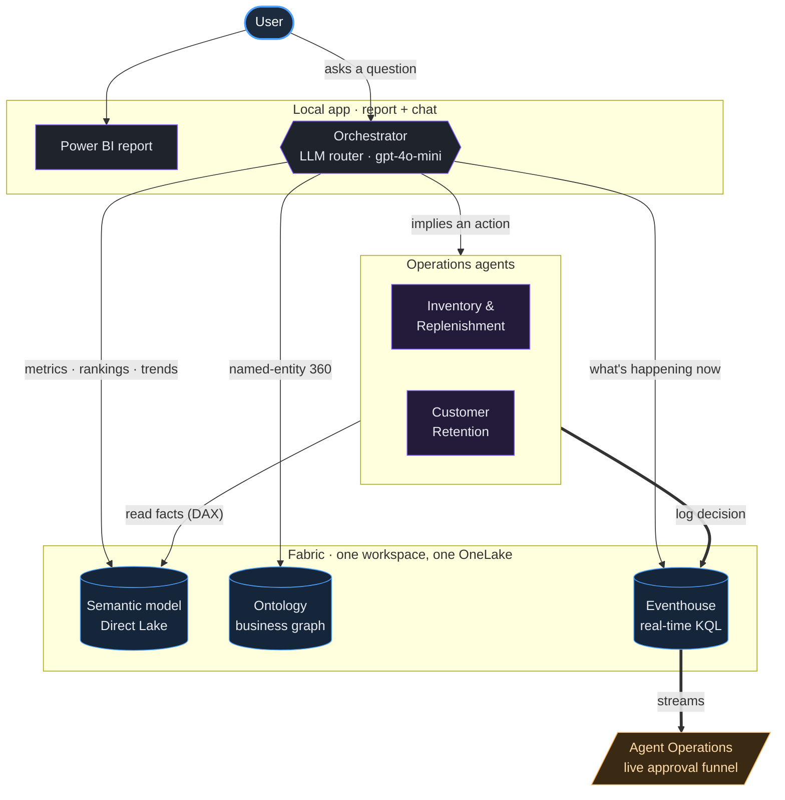

# Agentic application

The optional local application places chat beside an embedded Power BI report.
An orchestrator routes questions to Fabric data services or to operations
agents that draft replenishment and retention proposals.

The Fabric data platform and the optional local application have different
trust boundaries. The app can run synthetic replay, uses operator credentials
for live calls, and delivers an embed token to the browser. Its approval store
is local and its Eventhouse telemetry is best-effort, not durable production
audit. Check the environment's readiness report before using live features.
See [decision boundaries](../specifications/modules/ml-ai/decision-experience.md).

For the underlying streaming, Lakehouse, Eventhouse, and semantic-model
architecture, see [Architecture overview](overview.md).

## What it is, and why it's useful

The app uses the deployed `retail-demo` workspace to answer business questions
and prepare local action drafts:

- It routes metrics to the semantic model, named-entity relationships to the
  ontology, and supported live-sales questions to recent event data. A trace
  records the selected route and reason.
- When a user requests an action, an operations agent reads the deployed
  synthetic data, applies business rules, and drafts a proposal for human review.
- It attempts to send recommendations and approvals to Eventhouse. Ingestion
  failures can be suppressed, so verify delivery separately from the UI state.

The data platform uses one Fabric workspace; the local app, browser,
identity, and router remain additional trust and cost boundaries.
The same Gold tables feed the report, the agents, and
the ML models. Eventhouse holds live sales and successfully delivered agent
telemetry.

## End-to-end architecture

The user works with a report and chat in one application. The orchestrator
selects a Fabric data service or operations agent for each question. These
services use the shared data platform; the app also attempts to log agent
decisions in Eventhouse.



## The pieces, left to right

### 1. The app surface: report + chat, side by side

The app is a small FastAPI backend serving a single-page front end with three pages:

- **Dashboard** places the Power BI report and chat side by side, using about
  70% and 30% of the space. The report uses user-owns-data embedding: the backend
  obtains a Microsoft Entra ID token from the developer's `az login` session.
  The demo does not require a separate app registration or service principal.
- **Agent Operations** refreshes an approval-funnel dashboard from Eventhouse
  `agent_actions`, with KPI cards, an events-per-minute timeline, a per-agent
  funnel, and a feed of ingested recommendations and approvals.
- **Ontology Explorer** displays business entities and their relationships.

The orchestrator chooses the data source for a question.

### 2. The orchestrator: which brain answers?

An LLM intent router (`gpt-4o-mini` on Azure OpenAI, authenticated through
Microsoft Entra ID) classifies each question into a route:

| Route | Goes to | Example question |
|---|---|---|
| Metric, ranking, trend, or ML rollup | Data Agent over the semantic model | "Top 10 stores by net sales, YoY %" |
| Single named entity, in context | Ontology MCP over the business graph | "What segment and churn risk does loyalty member LC012304678 have?" |
| Recent sales | Live-sales shortcut over event data | "Top products in the last 15 minutes" |
| Decision or action | Operations agent | "Stock is low. What should we do?" |

The live-sales shortcut currently uses a fixed 15-minute store-sales query.
It does not guarantee the product grain or time window requested in a question.
See the [routing specification](../specifications/modules/ml-ai/routing.md)
for gate order and fallback behavior.

To use Claude for routing, set `RETAIL_LLM_PROVIDER=anthropic` and
`RETAIL_ANTHROPIC_API_KEY`. The trace names the model used. If the LLM call
fails, a deterministic keyword router selects the route. The Data Agent and
ontology can fall back to each other when one cannot answer.

### 3. The two MCP servers: Data Agent and Ontology

The app calls both Fabric services through Model Context Protocol (MCP).
Each call is a JSON-RPC `POST` to a streamable-HTTP endpoint, authenticated
with a Fabric bearer token:

- Data Agent MCP (`.../dataagents/{id}/agent`) answers aggregates, rankings,
  trends, and ML rollups over the semantic model. Fabric translates natural
  language into DAX and returns the answer without the generated query.
- Ontology MCP (`.../items/{id}/ontologyEndpoint`) exposes the business graph.
  It connects a named entity's profile with related data, such as a customer's
  segment and churn prediction. Fabric translates the question into a graph
  query and returns rows with a natural-language summary.

Use named-entity graph lookups for relationships such as
`Customer → ChurnPrediction`. Route broad aggregations and deep scans to
the semantic model, and verify graph paths before presenting them.

You can connect to both MCP servers from VS Code. See the
[VS Code MCP setup](../../guides/deployed-analytics-ai.md#connect-from-vs-code-mcp) for the `.vscode/mcp.json` setup.

### 4. The operations agents: perceive, reason, recommend, log

When a user requests an action, the orchestrator selects an agent that runs
app-authored DAX. The trace can show these queries in full.

Inventory & Replenishment reads stockout-risk predictions, checks
`fact_reorders` for SKUs without an open reorder, and joins `dim_products`
for prices. It applies a 14-day inventory-cover rule and drafts reorders
with **Approve** and **Dismiss** controls.

Customer Retention reads churn predictions, joins `customer_segments` for
lifetime value, and selects a ranked campaign cohort. It adds cross-sell
suggestions from the market-basket model and drafts a win-back campaign
with **Approve** and **Dismiss** controls.

Both agents estimate a proposal's value and require human review. Local
approval does not place an order or execute a campaign.

### 5. The closed loop: write-back to the Eventhouse

The app attempts to log drafts and approvals in Eventhouse
`agent_actions`, alongside live sales events. Successfully ingested events
feed the Agent Operations approval funnel and can be queried with KQL:

```kusto
agent_actions
| where action_ts > ago(1h)
| summarize count() by bin(action_ts, 1m), action_status
| render timechart
```

Successfully ingested events are queryable inside Fabric. The source
`app/backend/eventhouse.py` logs on daemon threads and suppresses failures;
durable audit, authenticated per-user approvals, and production actions need
the additional controls under `THREAT-009` / `SEC-012`.

## Under the hood: transparency and which model thinks

### "Show me how the agent got the answer"

The collapsible **how I reached this** trace below an answer records the
source, router model, decision reason, and exact MCP tool call and arguments.
For ontology results, it reconstructs an entity path from the returned
columns and shows a row preview. For operations agents, it shows the
app-authored DAX.

Fabric's Data Agent and Ontology services generate queries server-side and
do not return the query text. Their traces show the request and returned
evidence, not the hidden query.

### Which model is doing the thinking?

The application controls the intent-routing model, which defaults to Azure
OpenAI `gpt-4o-mini` and can be changed to Claude with an Anthropic key.
Fabric controls the models that translate natural language into DAX and
ontology queries. The application cannot replace those models.

## Why this matters

The application lets a presenter move from a report value to a question and
then to a reviewable local proposal using the same retail data. Pricing,
logistics, and marketing agents remain proposed extensions; see the
[decision experience specification](../specifications/modules/ml-ai/decision-experience.md).

For presentation steps, see the [CIO walkthrough](../../guides/cio-walkthrough.md).
