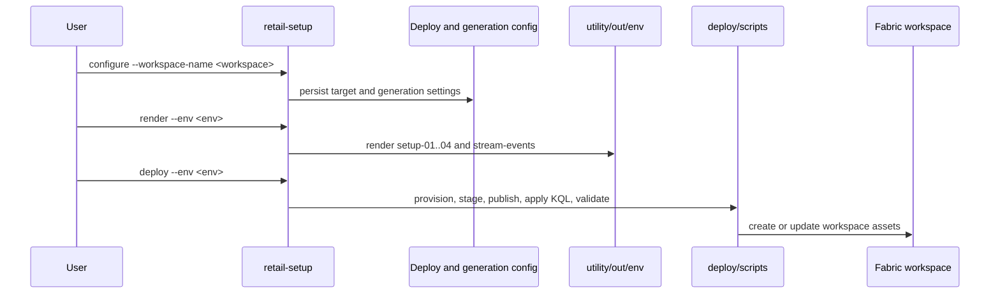
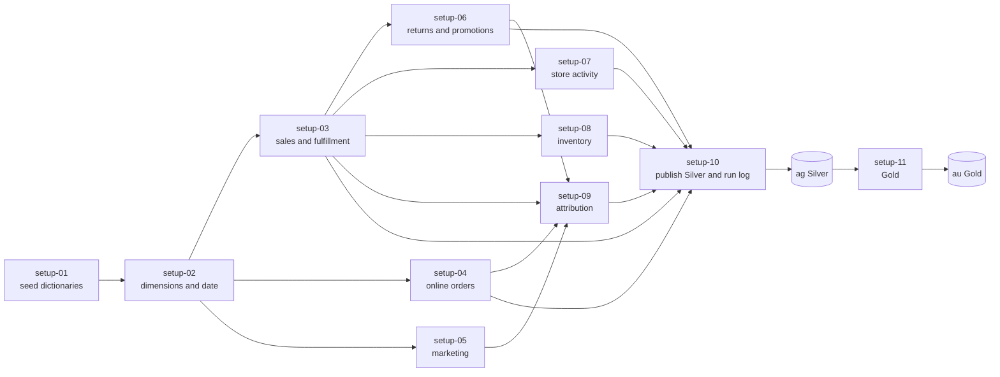
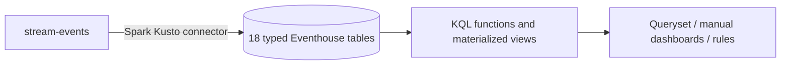
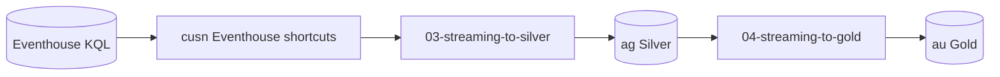
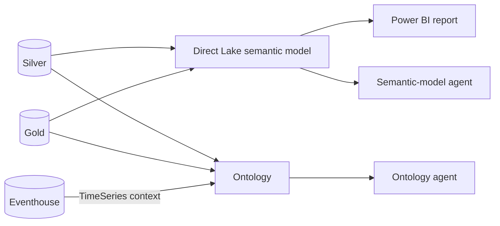

# Data flow

## Configure, render, and deploy

The historical range is normally derived from `months` and ends yesterday.

## Historical setup

This is the supported new-workspace historical path.

## Live Eventhouse path

The Spark Kusto connector groups Spark rows and writes them into Eventhouse
KQL tables. It is the direct connection between the optional stream notebook
and Fabric's real-time store.

`unknown_event` is a KQL catch-all table, not a generated business event type.

## Optional Eventhouse-to-Lakehouse projection

This path uses `ag._watermarks`. Its committed pipeline schedule is disabled.
Its streaming-only `fact_online_order_status` output is explicitly inventoried:
the Silver notebook owns its schema and routes, the manifest owns its terminal
exception, and the Delta maintenance notebook includes the table.
The same maintenance inventory owns the `ag._watermarks` control table.

## Consumption

## Operational state

Source evidence remains distributed across:

- `setup_run_log`
- `ag._watermarks`
- Fabric notebook/pipeline history
- Eventhouse ingestion state
- ML model output metadata where present

`retail-setup verify` queries these sources through one bounded, redacted
report. Required historical, Reporting, ontology, Data Agent, and task-flow
evidence has been exercised live. The remaining
[IMP-013](../requirements/modules/operations/backlog.md#imp-013) boundary is
recent evidence from the intentionally manual stream.
