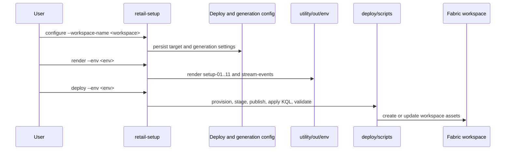
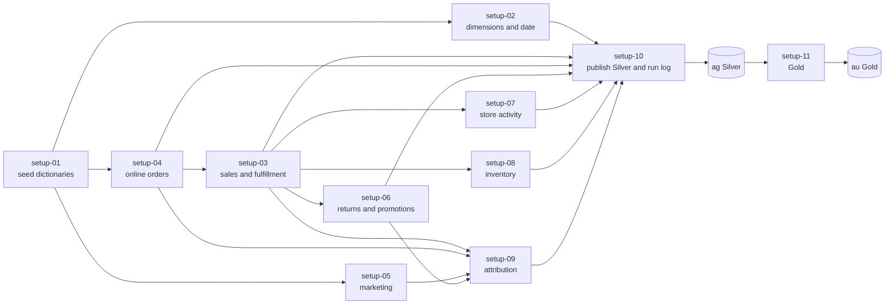
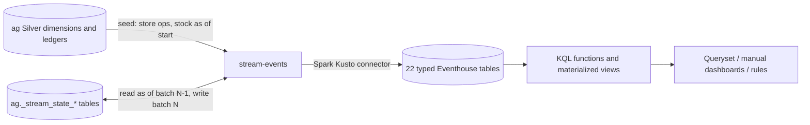
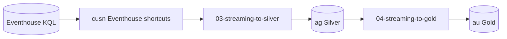
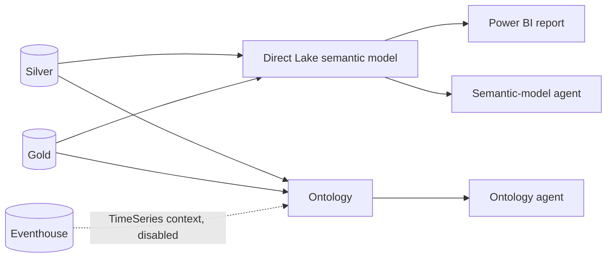

# Data flow

## Configure, render, and deploy

The historical range is normally derived from `months` and ends yesterday.

## Historical setup

This is the supported new-workspace historical path. Setup-03 waits for
setup-04 because ship-from-DC online lines draw the DC stock that store
reorders also use, so at most five setup notebooks run at once. Every setup
notebook regenerates the same deterministic dimensions from the seed and
`anchor_date`; only setup-10 publishes them. Setup-11 runs in `ml-required`
and holds the `gold` writer lock (see [Writer locks](#writer-locks)).

Generation runs in each store's local time and publishes true UTC timestamps.
`dim_stores.TimeZone` and `fact_receipts.local_hour` carry the store-local
view. The logistics incident model (`incidents.py`) and the DC stock
simulation (`dc_supply.py`) run inside setup-08 and publish
`fact_logistics_incidents`, `fact_logistics_incident_stores`, planned and
actual truck arrivals, and `fact_dc_inventory_txn`.

## Live Eventhouse path

The Spark Kusto connector writes groups of rows from the optional stream
notebook directly to Eventhouse KQL tables, one write per table every 60
seconds. Each micro-batch is generated inside `foreachBatch` from the same
models as history (traffic calendar, customers, baskets, prices, payments,
attribution, incidents). State that spans micro-batches lives in versioned
Lakehouse Delta tables: store open/closed state, in-progress visits and online
orders, store stock, pending loads, shipments and trucks, and the batch clock
(`_stream_state_stores`, `_visits`, `_orders`, `_inventory`, `_logistics`,
`_meta`). Batch N reads each entity as of batch N-1 and replaces its own
versions, so a replay emits the same events and applies nothing twice. A new
checkpoint incarnation seeds store state from Silver `fact_store_ops` and store
stock from the Silver ledger as of its start. The stream plans the same
logistics incidents as history and emits `logistics_incident_started` and
`logistics_incident_resolved` once each; an outage holds its DC's dispatches.
See the [live event contract](../specifications/modules/streaming/event-contract.md#stream-state).

`unknown_event` is a KQL catch-all table, not a generated business event type.

## Optional Eventhouse-to-Lakehouse projection

This path uses `ag._watermarks`. Its schedule is enabled by `schedules.streaming_data_load`, which defaults to `stream.start_after_deploy`.
The Silver notebook defines the schema and routes for the streaming-only
`fact_online_order_status` table. The manifest records its downstream exception,
and Delta maintenance includes it in the table inventory.
That inventory also includes the `ag._watermarks`, `ag._job_locks`, and
`ag._stream_state_*` control tables.

Notebook 03 is incremental: each source replays a three-hour overlap from its
watermark, attribution reconsiders only new purchases and late arrivals, and
truck lifecycles read only the replay window's departures and their arrivals.
DC stock moves (`inventory_updated` rows without a store) go to
`fact_dc_inventory_txn`, and both incident events feed
`fact_logistics_incidents` (one row per incident, `MERGE`d on resolution) and
`fact_logistics_incident_stores`. Notebook 04 and setup-11 build Gold from one
definition, `generation/gold_rules.py`.

## Writer locks

Pipelines on independent schedules write the same Delta tables. Writers hold
leases in `ag._job_locks` (`generation/job_locks.py`, copied into each
notebook):

| Lock | Holders | Behavior when held |
| --- | --- | --- |
| `silver` | 03, 90 | 03 skips the run after 10 minutes; 90 fails |
| `gold` | 04, setup-11 | 04 skips; setup-11 fails after an hour, then its activity retries |
| `ml:<table>` | the six required ML producers | the producer waits 30 minutes, then fails and its activity retries |

Notebook 05 claims each table's lock without waiting and skips locked tables.
Leases last 15 minutes and a heartbeat renews them, so a crashed writer's lock
expires. `fabric/pipelines/README.md` explains how to clear a lock by hand. The locks coordinate cooperating notebooks; they are not an access
control, and a writer outside these notebooks ignores them.

## Consumption

## Operational state

Operational evidence comes from:

- `setup_run_log`
- `ag._watermarks`
- `ag._job_locks` (current writer leases)
- stream checkpoint incarnation records and ingest tags
- Fabric notebook/pipeline history
- Eventhouse ingestion state
- ML model output metadata where present

`retail-setup verify` queries these sources through one bounded, redacted
report. Required historical, Reporting, ontology, Data Agent, and task-flow
evidence has been exercised live. The remaining
[IMP-013](../requirements/modules/operations/backlog.md#imp-013) boundary is
recent evidence from the intentionally manual stream.
