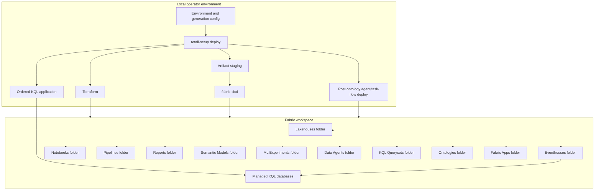

# Infrastructure

## Deployment topology

## Resource ownership

Terraform provisions or resolves the Fabric workspace, Lakehouse, Eventhouse,
KQL database, and optional custom Spark pool. `fabric-cicd` (Microsoft's
open-source Python library for deploying source-controlled Fabric item
folders) publishes supported workspace items. KQL schema application runs
separately with the operator identity.

## Current item layout

| Location | Items |
| --- | --- |
| `Notebooks` | All selected notebooks, including setup, live driver, ML and case preparation; reset excluded |
| `Pipelines` | All pipelines, including `setup-pipeline` |
| `Reports` | Main report and connected twins |
| `Semantic Models` | Direct Lake semantic model |
| `ML Experiments` | ML experiment shells |
| `Data Agents` | Semantic-model and ontology agents, automatically published after ontology creation in full-demo |
| `Lakehouses` | Lakehouse and its managed SQL endpoint |
| `Eventhouses` | Eventhouses and their managed KQL databases |
| `KQL Querysets` | Bundled KQL queryset |
| `Ontologies` | Ontology and any service-managed children |
| `Fabric Apps` | Approvals app and any service-managed backing items |

The [deployment folder policy](../specifications/modules/deployment/framework.md#workspace-folder-mapping)
also covers independently movable graph models, SQL databases, Operations
Agents and Plans. Fabric moves child items with their parent rather than
allowing separate child folders. These managed exceptions are recorded in
`workspace-folder-report.json`.

## Pipeline topology

| Pipeline | Actual scope | Schedule |
| --- | --- | --- |
| `setup-pipeline` | Setup 01-04 | On demand; mandatory for Reporting profiles |
| `historical-data-load` | Retained historical-load notebook | On demand |
| `streaming-data-load` | Streaming Silver then Gold | Committed schedule disabled |
| `daily-maintenance` | Delta maintenance | Daily schedule committed disabled |
| `ml-required` | Six serialized required producers, then contract validator | On demand; terminal Reporting gate |
| `ml-optional` | Promoted optional outputs | Full-demo post-Reporting |
| `ml-experimental` | Experimental outputs | Full-demo post-Reporting |

## External dependencies

- Microsoft Fabric tenant and capacity
- Terraform 1.8 or later, below 2.0
- Azure CLI for guided setup and Terraform, or Azure PowerShell for Python
  clients with validated `--skip-terraform` outputs/provider credentials
- `fabric-cicd`
- `azure-identity`
- `azure-kusto-data`
- `mssql-python` on Windows/Linux, or Microsoft ODBC Driver 17/18 on macOS,
  for Lakehouse SQL readiness checks
- Fabric Spark and Spark Kusto connector

## Local deployment state

Each workspace name derives a local environment key. Its ignored environment
overlay, Terraform input, backend state, Terraform data directory,
`fabric-cicd` configuration, live outputs, and run journal stay under that
key. Generation configuration lives at
`utility/config/environments/<env>.yaml`, rendered notebooks at
`utility/out/<env>/`, and every publication phase stages under
`deploy/.generated/<env>/workspace/`. Different environments do not share
these local paths. Operators must still serialize runs for the same Fabric
target; path isolation is not a distributed lock.

## Current constraints

- The default `full-demo` inventory includes live-preflight-validated preview
  surfaces; explicitly selected `core` and `standard` inventories are
  preview-free.
- Task-flow deployment uses metadata behavior outside a stable Fabric item
  source-control contract.
- Offline validation does not prove live workspace readiness. The separate
  profile-aware verifier queries live Fabric, Kusto, and Lakehouse SQL
  surfaces. Prior full-demo evidence is a baseline, not proof of the current
  remediation; fresh required-path and optional-stream evidence remains
  environment- and run-specific.

See [deployment requirements](../requirements/modules/deployment/deployment.md)
and the [operations backlog](../requirements/modules/operations/backlog.md).
