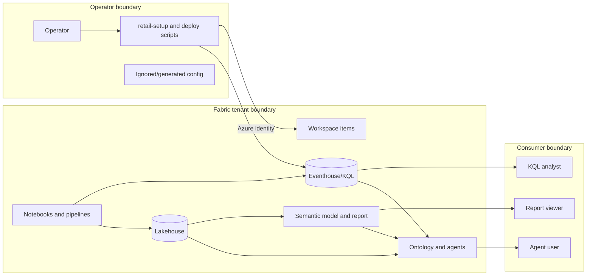

# Security architecture

See the [threat model](../security/threat-model.md) for security risks and
[controls](../security/controls.md) for their mitigations.

## Trust boundaries

## Identities

- Python deploy-time operations use an Azure CLI or Azure PowerShell operator
  identity. Terraform uses Azure CLI or an explicitly configured
  provider-supported service-principal, OIDC, or managed-identity credential;
  it cannot consume an Azure PowerShell session.
- KQL schema application runs from the local deploy process.
- The streaming notebook uses its Fabric runtime identity and needs ingestion
  rights on the target KQL database.
- Reports, KQL, ontology, and agents use assigned consumer permissions.

## Data handling

All records are generated synthetic data for demonstration only. Production
customer data is outside the supported boundary. Fabric workspace and item
permissions control access; row-level privacy controls for generated records
are not part of the default release.

## Current controls

- Local generation config and generated output are ignored.
- Secrets are expected from identity, secret stores, environment variables, or
  ignored files.
- KQL application is centralized.
- Direct streaming requires pre-existing tables through `FailIfNotExist`.
- Canonical public documentation is built only from reviewed `docs/` content.
- The default semantic model and agents may expose generated row-level detail
  to authorized workspace consumers.

## Verification boundaries

- Tenant-aware identity, bearer request handling, and target checks exist;
  alternate-authentication and renamed-target live proof remains `IMP-001`.
- Required Eventhouse writes raise on failure so Spark cannot commit a
  failed micro-batch. Replay/checkpoint and deep-reconciliation code has local
  tests, but fresh injected-failure Fabric proof remains outstanding.
- Environment-local configuration/render/staging and saved-plan guards do not
  replace operator review or serialize arbitrary remote writers.
- Prior readiness reports do not verify subsequent changes; collect fresh
  live evidence for the revision being deployed.
- The optional local app uses operator identity and browser token delivery for
  embedding; its proposal store is local and its Eventhouse telemetry is
  best-effort. See `THREAT-009` before describing this as durable governance.

See [access control](../specifications/modules/security/access-control.md) and
the [security backlog](../requirements/modules/security/backlog.md).
