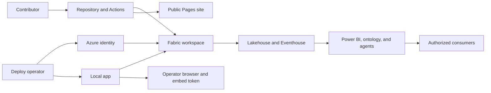

# Threat model

This document owns the security threats for the Microsoft Fabric Retail Demo.
Controls live in [controls.md](controls.md); implementation and verification
evidence lives in [traceability](../requirements/traceability.md).

## Scope and assumptions

- Microsoft Entra ID is the identity plane for Fabric access.
- Operators use Azure CLI or Azure PowerShell for Python clients; Terraform
  requires a provider-supported identity.
- GitHub Actions builds documentation and can run privileged automation.
- Supported records are generated synthetic data. Production customer data is
  outside the demo boundary.
- Preview Fabric features are not available in every tenant.
- Generated configuration and output are not durable sources of truth.
- The optional local app is a separate operator/browser boundary, not a hosted
  multi-user service secured solely by Fabric permissions. Live embedding
  sends an operator-derived Power BI token to the browser. Replay is not live
  query evidence.

## Assets

- Workspace roles, item permissions, and resource bindings.
- Lakehouse, Eventhouse, semantic-model, ontology, and Data Agent access.
- Deployment credentials, tokens, and environment-specific identifiers.
- Run-history, freshness, approval, and verification evidence.
- Canonical documentation and the public static site.

## Trust boundaries

## Threats

| ID | Threat | Impact | Required controls | Residual risk |
| --- | --- | --- | --- | --- |
| `THREAT-001` | Retired: workspace/model access exposes generated row-level customer-like data. | Records are synthetic and demo-only. | `SEC-001`, `SEC-002` | Row-level privacy controls for generated records are outside the release scope. |
| `THREAT-002` | Credentials or tokens are committed, logged, masked incorrectly, or sent to the wrong endpoint. | Unauthorized access or failed deployment. | `SEC-001`, `SEC-003`, `SEC-009` | Request headers, tenant propagation, and redacted journals have local contracts; ontology-notebook token-host allowlisting is implemented without a dedicated test; alternate-auth/renamed-target live proof remains `IMP-001`. |
| `THREAT-003` | Retired: an agent answers beyond its persona or returns generated row-level detail. | Records are synthetic and demo-only. | — | Mandatory persona/prohibited-detail controls are outside the default release; richer experiences remain optional under `ENH-003`. |
| `THREAT-004` | Mutable actions, plugins, or dependencies run with privileged tokens. | Supply-chain compromise or unreviewed changes. | `SEC-007` | Immutable repository references and locks have contracts; registries, OS package managers, and hosted runner images remain external trust roots. |
| `THREAT-005` | Activity, deployment state, or freshness is not observable. | Incidents or stale demo output go undetected. | `SEC-008` | Readiness has historical baseline evidence; current cleanup/degradation consistency and fresh required/optional execution remain open. |
| `THREAT-006` | Misbinding or unsafe reset targets the wrong tenant, workspace, or state. | Cross-environment modification or destructive loss. | `SEC-001`, `SEC-009` | Environment-local paths, fingerprinted resume, target validation, and saved-plan guards exist. They do not lock concurrent remote writers or replace operator review; live recovery drills remain outstanding. |
| `THREAT-007` | Required streaming or deploy failures are treated as success. | Lost integrity, advanced checkpoints, or false readiness. | `SEC-008`, `SEC-011` | Required writes and progress fail closed in source; fresh Fabric failure/recovery proof remains open. Successful promotion with cleanup warnings must degrade, not falsely fail, readiness. |
| `THREAT-008` | Public docs publish secrets, target-specific values, or temporary internal evidence. | Disclosure and stale guidance. | `SEC-003`, `SEC-010` | Review source and built files, not just navigation. Zensical publishes non-nav files; old tagged sites require separate inspection. |
| `THREAT-009` | The optional app presents replay, local approval, or lossy telemetry as authenticated production action/audit evidence. | False operational assurance, unauthorized future actions, or lost evidence. | `SEC-003`, `SEC-008`, `SEC-012` | Proposals are local drafts and Eventhouse logging is best-effort. Per-user authorization, production adapters, durable audit, evidence validation, idempotency, and scope limits are not established by an approval button. |
| `THREAT-010` | Notebook substitution executes configuration strings, or unverified/mismatched dictionary content is reused. | Unintended statements or irreproducible data. | `SEC-007`, `SEC-013` | Literal/JSON encoding, ref and cache checks, mutable refresh, and manifest-last publication are implemented; notebooks were rebuilt and drift checked. Explicit refs/fork overrides remain caller-selected; fresh live execution remains open. |

## Review triggers

Review when identities, public endpoints, agents, data classification, preview
defaults, external action adapters, or documentation publication boundaries
change. No fresh Fabric deployment was performed in this repair session.
