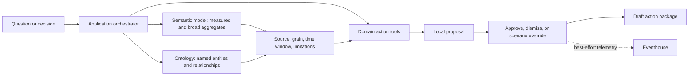

# Decision experience and action boundaries

This specification defines the proposed action layer and Retail customer
experience (CX). It replaces dated implementation plans; the Fabric profile
manifest still defines deployment selections.
`REQ-MLAI-005` remains `proposed`: the presence of replay/app code does not
prove the complete scenario, shared hosting, or production execution.

## Current local application boundary

`app/backend/main.py` routes questions to Fabric Data Agent and Ontology MCP
services, and to inventory/retention tools in `app/backend/agents.py`.
`app/backend/replay.py` supplies synthetic replay responses. Inspect the
selected mode before presenting any answer as live.

Live proposals are local JSON records managed by `app/backend/proposals.py`.
Approving a record changes its local status; it does not submit a purchase
order, send a campaign, or call an ERP, CRM, pricing, or workforce system.
`app/backend/eventhouse.py` sends telemetry on daemon threads and suppresses
ingestion errors. It is best-effort telemetry, not a guaranteed audit trail.
These limitations are tracked by `THREAT-009` and `SEC-012`.

## Native availability pack

`REQ-MLAI-006` covers a separate native experience, not a claim that
the full proposed CX application is implemented. The deployment entry point
is `deploy/scripts/deploy_operations_planning.py`; configuration and operator
steps live in the [deployment guide](../../../../guides/deployment.md#native-operations-agent-and-planning).

Configuration enables the pack by default whenever the profile provisions
Eventhouse and a semantic model, with `include_plan=false`. Because Fabric can
reject Operations Agent creation, an operations-only deployment step is
non-required: its failure is journaled and the deployment continues. Readiness
expects the Operations Agent as a non-required item, so its absence degrades
rather than fails readiness. Explicitly including the Plan restores a
required, fail-closed step.

`operations_planning.include_plan=false` selects Operations Agent and its
draft notebook independently. It bypasses only unselected Planning prerequisites,
not authentication or validation for a selected Plan. No model connection is
changed and no fixed credentials are created. Agent instructions and notebook
notes route human review to the Lakehouse draft table and existing SSO report
instead of a nonexistent Plan. Readiness excludes the unselected Plan.
Use this mode when organizational policy prohibits fixed credentials; native
Planning is unsupported in that environment, not silently simulated.

The bounded **Protect weekend availability** scenario uses store IDs 1-5 and
product IDs 1-20 in both the agent and Plan. It takes current `au.stockout_risk`, joins the next seven
forecast days from `au.demand_forecast`, and resolves product names through
`ag.dim_products`. Missing, non-finite, negative forecast, duplicate-grain,
out-of-scope, stale, and future evidence fail closed. A known negative stock
ledger is not inbound supply; the available-stock measure has a zero floor.
Inventory's last movement time can precede the forecast's common source
anchor. Both timestamps remain explicit; publication time does not replace
either. Case identity includes store, product, and both source timestamps.
Risk retains its own `risk_horizon_days` (default three); it is not relabeled
as seven-day risk. The Plan's additive `Next 7 Days` measures slice forecast
dates rather than filtering horizon metadata: the demand model defaults to
fourteen days. Existing full-horizon measures remain unchanged.

`fabric/operations/01-availability-tables.kql` owns
`ops_availability_signals` and `ops_case_actions`. These are selected-pack
tables, not the optional retail event stream. Seeding them must not satisfy
stream watermarks, ingestion, or checkpoint freshness. Consumers select the
latest monitoring event per case. Historical reorder rows do not establish
open commitments, confirmed inbound, reservations, or shared DC availability.

`retail-availability-operations` publishes stopped with its KQL database and
instructions. The REST publisher omits the empty `playbook` object so the UI
can generate it. The public definition API rejects `FabricJobAction`, so the
publisher follows item creation with the UI-native OA workload call and binds
`prepare-replenishment-case` using `itemArtifactId`, `itemWorkspaceId`, and
`RunNotebook`. It requires exact workload-service readback of one KQL source
and one action. The public service may normalize a KQL source ID to all zeroes
in definition readback; the workload readback is authoritative for configured
source/action details. Successful publication requires `shouldRun=false`.
Teams destination setup, playbook generation/review, and deliberate activation
remain operator steps. Deployment does not silently enable autonomous
purchasing.

The `prepare-replenishment-case` action validates a selected case against
live signals, freezes the inspected snapshot, and merges a DRAFT into
`<lakehouse>.ops.replenishment_cases`. It never overwrites an existing case.
Existing APPROVED or RESOLVED cases are not relabeled or audited as DRAFT.
An idempotently tagged Kusto audit follows the durable Delta write. The
two services are not an atomic transaction: failures propagate and a retry
can finish the missing audit without duplicating the draft. Historical
`ag`/`au` tables and external purchasing systems remain unchanged.

`retail-replenishment` is a native **Plan**, not another autonomous agent.
Its supported `PlanV1` definition binds the deployed semantic model through
an explicitly supplied shared Power BI Semantic Model connection
(`PowerBIDatasets`, OAuth2 or ServicePrincipal). Separately, the underlying
Direct Lake-to-data connection must use fixed credentials, not Automatic/SSO.
WorkspaceIdentity can be valid for that underlying hop but is not a supported
substitute for the Plan-to-model connection. The deploy inspects both without
automatically rebinding the existing model. The deploy must
reject missing connection or unacknowledged billing before creating either
component of a combined request. `--operations-only` is an explicit partial
operation when configuration still includes the Plan. A persistent
`include_plan=false` selection requires only the Operations components.

Native planning what-if inputs are assumptions until confirmed. There is no
public run-Optimize API in this implementation and no automatic bridge from
Plan writeback to an ERP, or from a case row into a new semantic-model table.
The planner uses the case's store/product identifiers for the human handoff.
Native application-database bootstrap, interactive model access, approval
workflows, and SQL writeback need separate in-product acceptance. Plan
creation/opening can start a non-cancellable 30-day billable session.

The source definitions are not added to unsupported `fabric-cicd` item
types. Native item APIs perform idempotent name resolution, bounded
long-running-operation polling, and definition readback. Duplicate names,
untrusted polling hosts, denied requests, and mismatches fail explicitly.
Supported existing task-flow bindings remain unchanged until native
artifact-type support is established.

## Responsibility split

Use semantic-model measures for rankings, period comparisons, conversion,
velocity, margin, and prediction rollups. Use the ontology for named-entity
context, serving-node/compatible-SKU paths, and evidence relationships. Do
not substitute an unbounded graph scan for broad analytical queries.
The active live generator writes directly to Eventhouse through Spark Kusto,
not through Eventstream.

## Proposed action roster

Only inventory and retention have local action-tool implementations.
The remaining domain tools and multi-agent composition require acceptance
and verification under the ML/AI backlog.

| Domain | Evidence and decision | Proposed draft |
| --- | --- | --- |
| Inventory | Stockout risk, forecast, balances, and covering reorders; serving DC/truck path | Reorder, expedite, rebalance, or safety-stock review |
| Retention | Churn, segment/LTV, purchase context, and market-basket cross-sell | Cohort win-back brief and offer suggestions |
| Pricing | Elasticity, promotion discount, margin, and price recommendation | Price/promotion review with quantified assumptions |
| Store operations | Velocity, conversion, checkout dwell, and anomalies | Staffing, lane, investigation, or store task |
| Fulfillment | Predicted truck dwell, lane delays, fulfillment mix, and uncovered demand | Dispatch/route/fulfillment review |
| Merchandising | Association lift/confidence, sell-through, spread, and returns | Bundle, placement, assortment, or quality review |

An actionable recommendation requires a quantified gap, a decision owner, and
a reversible first step. Informational executive, channel, segment, forecast,
journey, or association questions must not silently create actions.
Composite opportunities include revenue-at-risk retention, stockout/sales
protection, margin recovery, and a prioritized per-store action list.
Illustrative financial impacts are assumptions, not realized savings.

## Proposed guardrails

| Tier | Meaning | Required boundary before enabling execution |
| --- | --- | --- |
| T0 | Inform without a write | Identify source and uncertainty |
| T1 | Draft a local proposal | Display evidence; human review before promotion |
| T2 | Reversible external execution | Explicit authenticated approval and durable outcome record |
| T3 | High-impact price, offer, or large reorder | Approval plus reason, limits, and audit evidence |

Only the local draft/review boundary is in scope today. Future tools must
validate IDs against source rows, use configurable numeric thresholds, check
covering/repeated actions for idempotency, cap fan-out, and retain the asker,
evidence, tier, approver, outcome, and decision time. These are proposed
controls, not guarantees of the existing prototype.

## Proposed Retail CX scenario

The fictional **Aster & Pine Outfitters** scenario, **Protect the Winner**,
follows **Dana Reyes**, a regional merchandising lead:

1. A declining Performance Footwear category contains a growing Momentum
   Runner product family. Compare periods and store/channel contribution.
2. Find named products/SKUs, stock snapshots, stores, regions, channels, and
   fulfillment nodes through explicit relationships.
3. Activate sufficiently covered stores, replenish high-velocity constrained
   stores, and propose compatible transfers from slower excess-stock stores.
4. Remove one source store with a required human reason; retain the original
   recommendation and recalculate candidates.
5. Produce a draft transfer/replenishment list, activation brief, execution
   checklist, evidence bundle, owner, review date, and decision/override log.

Reserved inventory remains at its certified fulfillment-node/product grain.
Never infer store allocation, SKU compatibility, or a relationship absent
from source data. Separate selling, fulfilling, and source stores; use one
inventory snapshot/as-of time, aggregate numerators and denominators before
ratios, and align periods with the scenario's fiscal calendar. Distinguish
observed facts, derived values, and recommendations; return unsupported when
required evidence is missing.

## Proposed experience and replay contract

- **Decision Cockpit:** synthetic label, report or replay, morning brief,
  guided prompts, route badge, and evidence/query trace.
- **Story Studio:** chapter navigation, Work/Fabric/Foundry/Web IQ cards,
  signal state, independent Question Lab, explicit action trigger, decisions,
  and links to the canvas and operations.
- **Decision Canvas:** signal, diagnosis, certified-grain constraint,
  recommendation, override, draft package, owner, and review state.
- **Ontology Explorer:** entities, properties, relationships, and highlighted
  paths used by the selected answer.
- **Agent Operations:** proposal states, approvals/dismissals/overrides,
  modeled impact assumptions, evidence ownership, and live/replay provenance.
- **Walkthrough:** capability explanation, validated click path, and fallback.

Replay and live modes must use the same response contracts and components.
Replay must visibly say **REPLAY — SYNTHETIC DATA** and work without Fabric
credentials. A versioned fixture must include KPIs, prompts, metric/graph
answers, graph paths, cards, override response, action package, and telemetry.
Do not silently present fixture data as a successful live query.

## Proposed data and packaging

Generate all records independently, never by copying, sampling, perturbing,
or hashing customer records. Use fictional vocabulary and opaque keys; keep
real contact details, credentials, environment identifiers, and customer
response logs out of source, fixtures, and screenshots. Review generated
content before publication (`SEC-003`, `SEC-010`, `SEC-012`).

The scenario package needs a fixed seed/date/scale run ID, source-separated
JSONL or Parquet, file checksums, row counts, reconciliation results, and
golden answers. It should intentionally exercise category decline/product
growth, three high-velocity low-cover stores, four activation-ready stores,
two excess-stock stores, an override, and an aggregate-grain DC constraint.
These are scenario requirements, not changes to historical `TABLES`.

Potential future entities include ProductFamily, SKU, InventorySnapshot,
FulfillmentNode, TradingSignal, DecisionScenario, Recommendation, Evidence,
Decision, Override, and ActionPackage. Extend the authoritative model and
ontology contracts before claiming these relationships exist.

Reuse the standalone app before considering hosted delegated-identity or
Fabric Workload packaging. Keep backend/UI contracts portable; a new agent
framework is optional, not a prerequisite. Shared hosting, service identity,
secret management, durable approvals/audit, external adapters, and a native
Fabric shell require separate design and tests.

## Verification still required

Run the complete five-act story in replay without credentials, assert answers
and override transitions, verify synthetic labels and no production writes,
and exercise degraded live-service behavior. Separately validate live
Fabric/model/ontology bindings and telemetry delivery with retained run
evidence. Golden replay answers are not live readiness proof.
