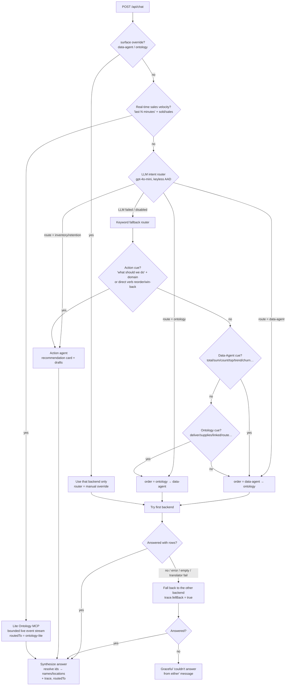

# Chat orchestrator: how questions are routed

Retail Intelligence chat (`app/`) routes questions to the Fabric Data Agent,
Ontology MCP, or an Inventory or Retention action agent. This page describes
route selection and what happens when a data service cannot answer.

The orchestrator lives in `app/backend/main.py` (the `/api/chat` handler, `_orchestrate`,
`_route_with_reason`, `_action_route`) plus the LLM classifier in `app/backend/llm_router.py`.

This describes local source behavior, not guaranteed live service responses.
Replay bypasses live routing. Inspect the actual response trace and mode;
fallback cannot make unavailable Fabric services or missing data ready.
See [decision and security boundaries](decision-experience.md).

## 1. Destinations {#1-the-three-four-destinations}

| Route | Backend | Best for |
|---|---|---|
| `data-agent` | Fabric Data Agent over the `retail_model` semantic model (Direct Lake) | Aggregates, KPIs, rankings, trends, time windows, ML rollups, and broad scans |
| `ontology` | Ontology MCP (entity relationships, including Eventhouse telemetry) | A named customer's, product's, or store's related data; one-hop lookups |
| `inventory` | Inventory & Replenishment action agent | Requests to act on stock or replenishment; returns a recommendation card and draft reorders |
| `retention` | Customer Retention action agent | Requests to act on churn or retention; returns a recommendation card and draft campaign |

The action agents (`inventory`, `retention`) return their own answers without
fallback. For `data-agent` and `ontology`, the router ranks the two services:
it tries one first and uses the other as a fallback.

## 2. The decision flow

## 3. Step-by-step

The handler evaluates these gates in order; the first match wins.

1. Manual override (`surface`): if the request sets `"surface": "data-agent"`
   or `"ontology"`, the handler uses only that backend, with no fallback.
   Debugging and the UI's force-a-source control use this override.
   The router label is `manual override`.

2. Real-time sales-velocity shortcut: a regex matches questions such as
   "which sold the most in the last 15 minutes" using a last/past time window
   and a sales verb. The shortcut sends a fixed 15-minute store-sales query to the lite ontology
   over Store and `receipt_created`, returning `routedTo = ontology-lite`.
   It does not guarantee that arbitrary requested windows or product grain are
   honored. Historical Gold also has a latest-window snapshot, but that is not
   evidence of a current live window. Shortcut failure falls through to normal
   routing.

3. LLM intent router (`llm_router.classify`): a `temperature=0` JSON
   classification call uses Azure OpenAI `gpt-4o-mini` by default,
   authenticated through `az login`. Set `RETAIL_LLM_PROVIDER=anthropic`
   to use Claude. It returns `{"route", "reason"}` using a system prompt
   and about 14 examples that encode this policy:
   - A named entity and its related business, ML, or telemetry data go to ontology (Customer-360,
     "which stores are at risk of selling out *White Truffle Powder*", "for store S000028, how many
     `stockout_detected` events and which products").
   - Aggregates, rankings, trends, ML rollups, and broad scans go to data-agent.
   - An action verb (should, do, prevent, draft, create, reorder, replenish,
     launch, recommend) with a domain selects inventory or retention.
     "Which customers are at risk" is a lookup, not an action request.

   The chosen route also sets the fallback order: `data-agent` → `[data-agent, ontology]`;
   `ontology` → `[ontology, data-agent]`.

4. Keyword fallback router: if the LLM call fails, times out, returns bad JSON, or is disabled
   (`RETAIL_LLM_ROUTER=0`), a deterministic keyword router provides a local fallback:
   - `_action_route` selects the matching agent for an action cue
     (`what should we do`, `recommend`, `how do we`) plus an inventory or
     retention domain word, or a direct verb such as `reorder`, `replenish`,
     `win-back`, or `retain`.
   - Otherwise, `_route_with_reason` tries data-agent first for cues such as
     `total`, `sum`, `count`, `top`, `trend`, `churn`, `revenue`, and `%`.
     It tries ontology first for cues such as `deliver`, `supplies`, `linked`,
     `route`, `which stores`, and `connected to`. With no cue, it defaults to
     data-agent first.

5. Execution and fallback: the handler tries the chosen `order` in sequence. A backend fails
   (and falls through to the next) when it raises an HTTP/timeout error, returns empty / "no
   results", or the ontology translator emits a transient bad-query error after its retries. If the
   first succeeds, the second is never called. If both fail, the response
   says neither service could answer, rather than returning a 500.

6. Answer synthesis and trace: the synthesis step resolves bare ontology
   `store_id` and `product_id` integers to store numbers, locations, and product names.
   Every response carries `routedTo` and a trace (router model, decision reason, steps, the exact
   MCP call, the reconstructed graph path, a raw-row preview, and whether it `fellBack`).

   The store/product lookup helpers use the explicitly imported `dax` client
   to query semantic-model rows. `tests/app/test_lookup_indexes.py` covers the
   import and row-to-name mapping regression. This is local lookup coverage,
   not proof of a successful remote semantic-model query.

## 4. Why two routers?

The LLM router distinguishes a lookup such as "which customers are at risk"
from an action request such as "churn is rising, what do we do." The keyword
router provides a deterministic route choice without a network call when
the LLM is unavailable. Downstream Fabric calls can still fail; choosing a
route does not guarantee an answer.

## 5. Worked examples

| Question | Route | Why |
|---|---|---|
| "What were total net sales and gross margin company-wide?" | **data-agent** | Aggregate financial metric. |
| "Give me the 360 view of the customer with loyalty card LC012783099." | **ontology** | Single named customer enriched with segment + churn + profile. |
| "Which stores are at risk of selling out White Truffle Powder?" | **ontology** | 1‑hop lookup: a named product's stockout-risk prediction → linked stores (no action verb). |
| "For store S000028, how many `stockout_detected` events and which products?" | **ontology** | One named store's own live event telemetry, walked to its affected products. |
| "Which products sold the most in the last 15 minutes?" | **ontology-lite shortcut** | Currently uses a fixed store-sales query; inspect grain rather than treating this as a verified product answer. |
| "How many customers are predicted to churn and their total LTV?" | **data-agent** | Aggregate count/value over the ML churn table. |
| "Stock is running low. What should we do about it?" | **inventory** | Action cue and inventory domain select draft reorders. |
| "Churn is rising. How do we retain customers?" | **retention** | Action cue and retention domain select a draft win-back campaign. |

## 6. Knobs

| Env var | Effect |
|---|---|
| `RETAIL_LLM_ROUTER=0` | Force the deterministic keyword router (skip the LLM). |
| `RETAIL_LLM_PROVIDER=anthropic` (+ `RETAIL_ANTHROPIC_API_KEY`) | Route with Claude instead of gpt-4o-mini. |
| `RETAIL_ONTOLOGY_TIMEOUT` | Seconds the ontology MCP gets before the orchestrator falls back. |
| Request body `"surface": "data-agent"\|"ontology"` | Force one backend (no routing, no fallback). |
| Request body `"router": "keyword"` | Skip the LLM for that single request. |

Only the routing model is configurable by this application. Fabric controls
the models that translate natural language into DAX and ontology queries.
The trace names the router model that selected the route.
