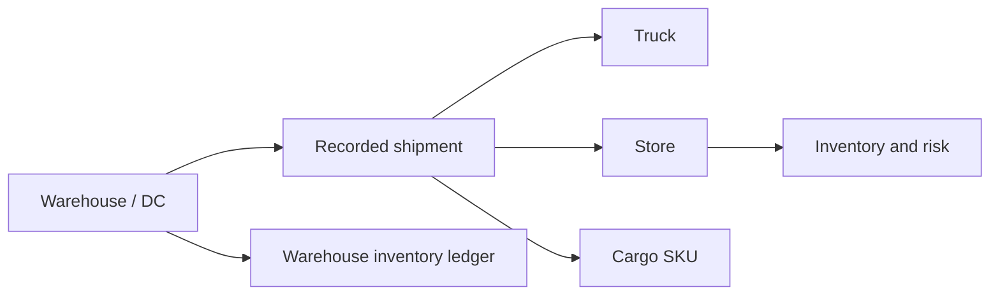

# Connected retail operational twins

This specification defines `REQ-OPS-005`: read-only views of stores, a
warehouse/distribution center, and trucks, using single sign-on (SSO).
The implementation is a native Power BI report on the existing Fabric
semantic model. It does not deploy Digital Twin Builder, Planning, or
Operations Agent products.

## Components and scope

`retail-twins` provides network overview, Store Twin, Warehouse Twin, and
Truck Twin pages. Native Power BI visuals query the signed-in user's existing
Direct Lake model. The optional local app's shared operator-token cache is
not involved.

The pilot includes one recorded DC, two trucks, up to five connected stores,
and up to twenty products found in their cargo records. If fewer products
are observed, the report shows that smaller set without inventing SKUs or
route links.
The model has no new physical geometry, GPS, temperature, driver assignments,
reservations, or warehouse-bin data.

## Source and cohort contract

`deploy/scripts/_twin_cohort.py` selects from
`ag.fact_truck_moves`, anchored to the newest event no later than the
observation time, with a fourteen-day lookback. Discovery reads at most
10,000 route rows, and the selected network keeps at most 1,000 shipments.
When a bound is exceeded, the cohort keeps the newest rows. It drops every
row at the boundary timestamp and moves `window_start` just past it, so
cargo and report queries cover a complete window. Missing, ambiguous, or
inconsistent shipment identity still fails. Both trucks must belong to the
same recorded DC network. Each truck's latest recorded destination is
included before filling the store set.

`ag.fact_truck_inventory` supplies observed cargo product IDs, joined using
both truck and shipment identity. All SQL parameters are bound values, not
interpolated shipment strings. The saved cohort retains the actual route and
shipment evidence. Shipment IDs document the selected network; they must
not become a permanent filter that hides every future shipment.

The displayed state is the latest recorded state in the selected scope,
with explicit source timestamps. Cohort selection time is not a replacement
for inventory, operations, or movement timestamps. Historical/synthetic
observations must not be labeled live telemetry.

## Entity semantics

Store state combines recorded operating events, signed and available stock,
observed stockout probabilities, and zone activity. Zone activity is not
exact occupancy or a count of unique shoppers. Risk retains the model's
actual forecast horizon; it is not automatically seven-day risk.

Warehouse state shows signed inventory and a nonnegative available-stock
view at DC/SKU grain. Neither is available-to-promise: reservations and
confirmed commitments are not known. Recorded shipment counts retain their
defined source-relative time window.

Truck state uses recorded shipment/status events, planned ETA/ETD, loading
and unloading evidence, and the current selected shipment's cargo ledger.
Unknown or ambiguous state stays unknown. A departed truck is not assigned
an invented GPS location or next destination.

The delay comparison adds sixty minutes to a recorded ETA as a clearly
labeled **what-if**. It does not change an actual timestamp, predict an
observed delay, recompute stockout probabilities, or place an order.

## Deployment and authorization

`twins.enabled` is independent and defaults to true whenever the profile
selects the semantic model and Report (`standard` or `full-demo`); `core`
cannot select twins. Selected twins publish after Reporting through the
non-required `deploy-twins` step: a failure degrades the run, and later steps
still run.
The targeted `deploy.scripts.deploy_twins` command can update an existing
workspace without rerunning historical generation.

The publisher requires the existing Automatic/SSO semantic-model binding.
It never creates a fixed-credential connection or changes model permissions.
Normal Fabric report/model/OneLake authorization remains the access-control
boundary; cohort filters and navigation are not row-level security.
Deployment uses the operator's login only to author and inspect artifacts.
Viewers use their own identity in Fabric/Power BI, not that operator token.

`deploy/scripts/_twin_model.py` merges only catalogued twin measures and
missing physical columns required by their expressions into the live model.
Partitions, expressions, roles, and unrelated measures remain intact;
conflicting existing column mappings fail rather than being overwritten.
Changed live definitions are backed up under the environment's generated
directory. The publisher reads back the additions, tolerates only equivalent
TMDL serialization, and checks SSO again. It refreshes Direct Lake framing
before data queries, including on retries with unchanged metadata, so new
physical columns and current source files are queryable. Refresh polling
tracks the exact accepted request and never changes credentials on failure.

Publication uses the supported Report REST definition API and a runtime
semantic-model GUID. It checks representative DAX queries for all three
entity sets before publishing the report. Native item readback verifies the
requested report definition. Disabled twins do not delete an existing report.

## Evidence and acceptance

`deploy/.generated/<env>/twins-report.json` records the cohort, source window,
model changes and backup, DAX evidence, report identity/link, and outcome.
The complete bounded cohort is preserved, not truncated into unusable
placeholder entries.

Source tests cover deterministic selection, actual route joins, invalid and
future evidence, model-merge isolation, template/model references, native
bindings, and opt-in orchestration. These are separate from service checks.
Native report acceptance additionally requires page rendering, selector/
navigation behavior, and appropriately scoped viewer access. A model query
or a report item ID alone does not prove those interactive properties.
The recorded deployment's native Report and DAX checks succeeded; automatic
image export is disabled by tenant policy. Do not enable export or relax
identity policy solely to bypass an acceptance-tool limitation.
