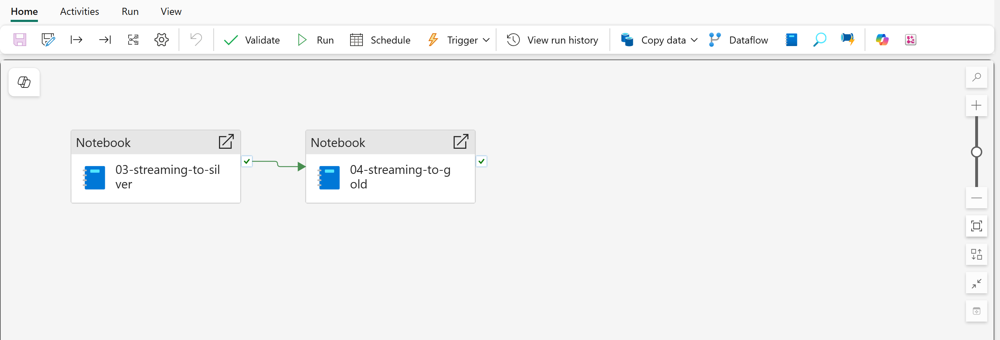
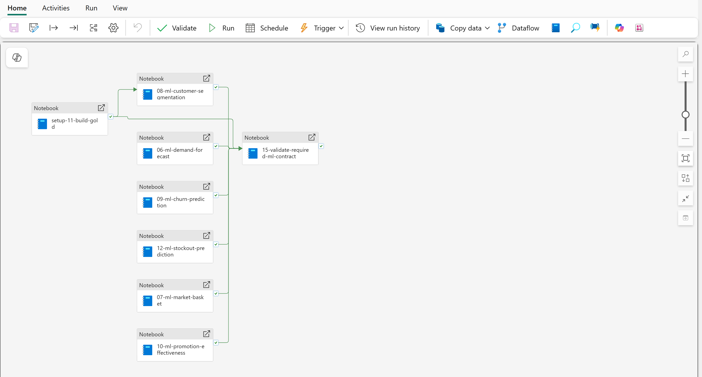
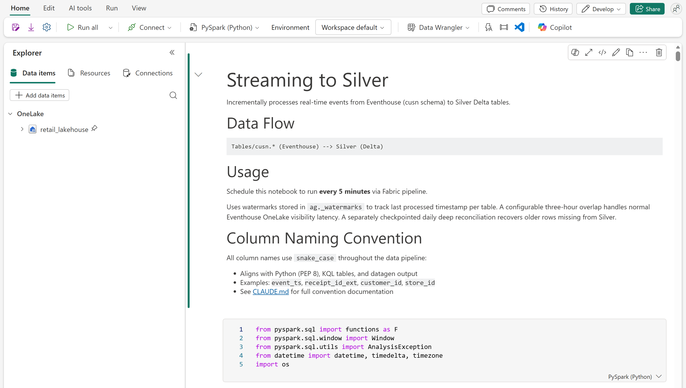
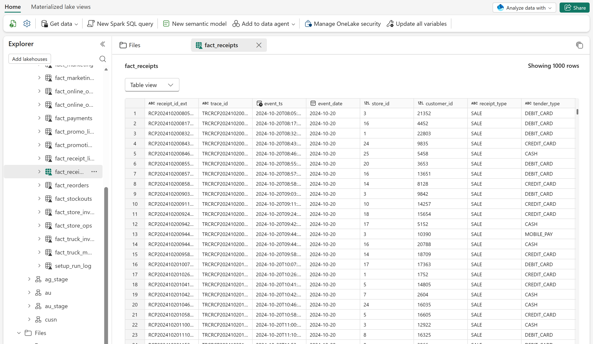
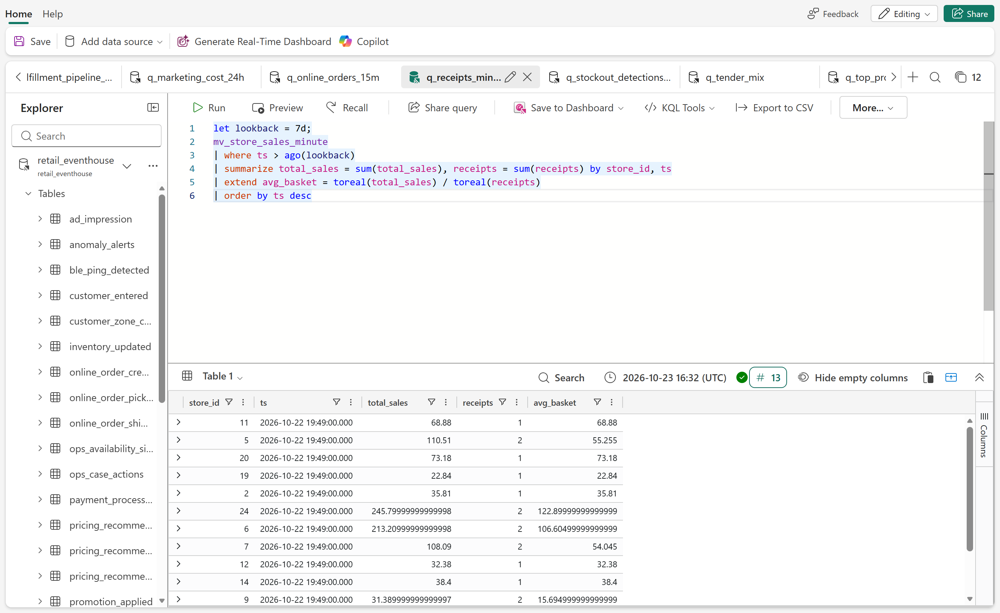

# Deployed walkthrough: data platform

- **Audience:** Data engineering, analytics, and technology stakeholders
- **Duration:** 10-15 minutes
- **Data:** Synthetic

Use this page after the
[deployed walkthrough overview](deployed-walkthrough.md) to show how Microsoft
Fabric orchestrates, transforms, stores, and queries the retail data.

!!! note "Representative screenshots"

    A deployed workspace can lag behind the repository. Use the current
    checked-in notebooks and schema contracts as the authority for exact
    behavior and field names.

## 1. Show pipeline orchestration

Open the **Pipelines** folder. Use the deployed pipelines to explain how
notebooks are grouped into repeatable operations:

- `historical-data-load` creates the durable historical foundation.
- `streaming-data-load` runs Silver transformation before Gold aggregation.
- `ml-required` runs the six Reporting producers (including market-basket
  mining and promotion/elasticity analysis) and contract validator.
- `ml-optional` and `ml-experimental` isolate full-demo extensions after
  Reporting.

=== "Streaming transforms"

    

    *The streaming pipeline sequences `03-streaming-to-silver` before
    `04-streaming-to-gold`.*

=== "Machine learning"

    

    *`ml-required` builds Gold with `setup-11-build-gold`, runs the six
    Reporting producers in parallel, and finishes with
    `15-validate-required-ml-contract`.*

    `ml-optional` and `ml-experimental` are separate pipelines, so
    extended-model failures cannot block Reporting.

The pipeline canvas shows orchestration order. Use the **Run** history and
activity output, not the presence of a green dependency arrow, as execution
evidence.

## 2. Inspect a transformation notebook

Open the **Spark Notebooks** folder, then open
`03-streaming-to-silver`.



*The notebook explains how new Eventhouse rows are moved into cleaned Silver
tables, how it remembers the last processed event, and why column names use
lowercase words separated by underscores.*

Use the notebook header to explain the transform without scrolling through
implementation details. Do not run the notebook until its Lakehouse binding
and source tables have been verified.

The optional Eventhouse projection is prepared during deployment when
`streaming_shortcuts.enabled` is true. For `retail-demo`, the deployment
provisions OneLake mirroring with historical backfill and creates or verifies
the shortcuts under `Tables/cusn/` after KQL publication. The selected
five-minute mirroring latency favors demo freshness but can produce smaller
Parquet files; do not treat it as a production tuning recommendation.

## 3. Inspect durable Lakehouse history

1. Open `retail_lakehouse`.
2. Expand **Tables**, then the `ag` schema.
3. Select `fact_receipts`.



*The Lakehouse explorer shows the Silver `ag.fact_receipts` table and a row
preview from the generated historical dataset.*

Point out:

- `ag` contains cleaned, typed Silver dimensions and facts.
- `au` contains business-ready Gold summaries used for analytics.
- `fact_receipts` provides durable receipt-grain history.
- The preview demonstrates shape and content, not current operational
  freshness.

Use the authoritative
[historical data contract](../design/specifications/modules/generation/data-contract.md)
when explaining table ownership and columns.

## 4. Inspect the Eventhouse hot path

1. Open the `retail_querysets` KQL (Kusto Query Language) queryset.
2. Confirm that `retail_eventhouse` appears in **Explorer** with the typed
   event tables.
3. Select the `q_receipts_minute_by_store` tab. It reads the
   `mv_store_sales_minute` materialized view, a bounded hot-path aggregation.
4. Select **Run**. If no stream has run in the last hour, widen `lookback`
   (for example to `7d`) to show the most recent results.



*The queryset reads per-minute store sales from the `mv_store_sales_minute`
materialized view. This capture uses a seven-day lookback.*

The materialized views are created by the numbered scripts in
`fabric/kql_database/` during deployment; the queryset holds the saved
operational queries.

For live evidence, run a read-only query against a recent window:

```kql
receipt_created
| where ingest_timestamp > ago(10m)
| project ingest_timestamp, store_id, receipt_id, total
| order by ingest_timestamp desc
| take 10
```

Recent rows prove that Eventhouse ingestion is active. If the query is empty,
show the schema and last known data timestamp, then follow the
[operations guide](operations.md) instead of claiming that the stream is live.
Do not run the numbered deployment scripts during a presentation.

## Data-platform validation

| Interaction | Expected result |
| --- | --- |
| Open `streaming-data-load` | The Silver notebook precedes the Gold notebook in the pipeline canvas. |
| Open `03-streaming-to-silver` | The notebook identifies Eventhouse sources, Silver targets, and watermark-based processing. |
| Select `ag.fact_receipts` | The Lakehouse explorer shows the table schema and a row preview after historical setup. |
| Run the recent receipt query | Rows have recent `ingest_timestamp` values when the optional stream is active. |
| Run `q_receipts_minute_by_store` | Per-minute store sales from `mv_store_sales_minute` return without errors (widen `lookback` if no recent stream ran). |

Continue with [Analytics and AI](deployed-analytics-ai.md).
