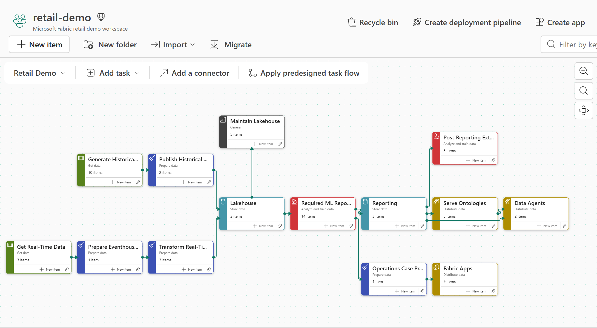

# Deployed solution walkthrough

Use this browser tour to introduce a deployed workspace to retail, analytics,
and technology teams. Allow 3-5 minutes for orientation or 15-25 minutes for
the full walkthrough. All data is synthetic. The
[presenter demo](demo-script.md) provides a detailed talk track and limits
on what to claim.

!!! note "Representative screenshots"

    The screenshots show a representative deployment. Fabric navigation,
    generated values, item counts, and data timestamps can vary by deployment
    and run date. Validate freshness before presenting any value as current.

## Before you start

1. Complete [Getting started](getting-started.md).
2. Open the deployed Fabric workspace.
3. Confirm that `retail_lakehouse`, `retail_eventhouse`, the KQL queryset,
   `retail_model`, the pipelines and notebooks, and any optional ontology or
   agent items you plan to show are available.
4. Run the historical setup notebooks. Run `stream-events.ipynb` only when the
   walkthrough needs recent Eventhouse data.

## 1. Orient the audience in the workspace

Open the workspace task flow and select the **Retail Demo** flow.

!!! info "Task flow is a full-demo experience"

    The task flow is published only after the `full-demo` ontology step is
    complete. If the workspace uses `core` or `standard`, skip this step and
    open the workspace item list. You can still follow the historical, live,
    and Reporting paths described below.

*The task flow maps ingestion, transformation, storage, the semantic model,
ontology, ML, agents, case preparation, and Fabric Apps. Required ML feeds the
Semantic Model; optional and experimental ML follows Reporting.*

Explain the paths through the flow:

- Load and transform deterministic retail history into the
  Lakehouse.
- Send typed live events to Eventhouse and optionally project them
  into Lakehouse tables.
- Make curated data available through the semantic model, Power BI,
  ontology, and Data Agents.

The task flow is a navigation aid. It does not prove that a notebook, pipeline,
or stream completed successfully.

## Continue the walkthrough

Choose the page that matches the audience:

| Walkthrough | Use it for |
| --- | --- |
| [Data platform](deployed-data-platform.md) | Pipelines, Spark notebooks, Lakehouse history, and Eventhouse/KQL |
| [Analytics and AI](deployed-analytics-ai.md) | Ontology, grounded data-agent answers, and the Power BI report |

For the complete demo, present the data platform first and finish with
analytics and AI. For a business audience, use this overview and go directly
to Analytics and AI.

## Shared support boundaries

- Screenshots show a representative deployment; item counts, values, and
  timestamps vary.
- A task-flow node or pipeline canvas is navigation context, not execution
  evidence.
- Validate the selected data period before discussing any value.
- Skip optional ontology, agent, ML, or live-streaming features that have not
  passed their source, permission, and capability checks.

For a timed presentation, continue with the
[presenter demo](demo-script.md) or a focused
[presenter journey](presenter-journeys.md).
